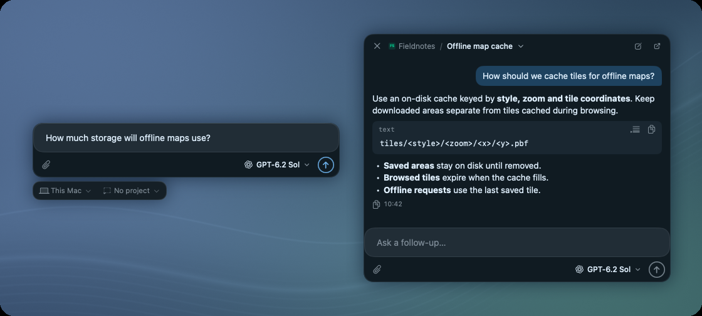
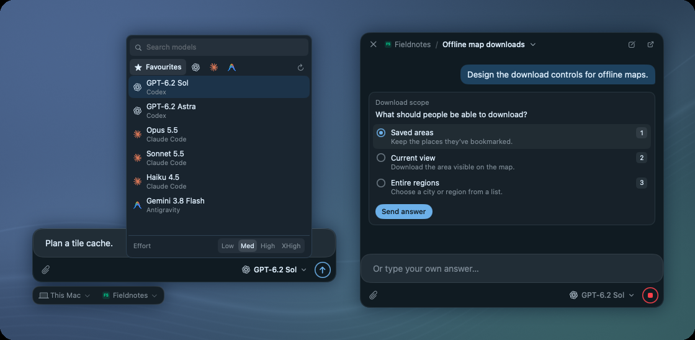

# Float

Float is a native macOS menu bar app for T3 Code. Press **Option–Space** to open a compact composer over your current app. Send a prompt and Float expands into a conversation with streaming replies, Markdown, and code blocks.



## Build and open

You’ll need macOS 14 or later, Swift 6, and a local T3 Code build with the thread and attachment MCP tools. Enable a model provider in T3 settings, such as Codex, Claude Code, or Antigravity, and sign in before sending your first prompt.

```sh
./App/build.sh
open dist/Float.app
```

If T3 isn’t running, use **Launch T3** in Float. Float saves your draft while it reconnects.

## Use Float

- **Start or resume a chat.** Press **Command–N** for a fresh chat or **Command–K** to find working, pinned, and active T3 threads across connected machines. For a new chat, leave the project set to **No project** or choose a workspace. Use **Run on** to pick a linked machine.
- **Compose a prompt.** Paste a screenshot or attach images with the paperclip, up to eight images of 10 MB each. Use the model picker to search models, access T3 favourites, and set effort where supported. Type `$` for skills or `/` for commands on this Mac.
- **Stay with the run.** Send a follow-up while the agent works. Float follows T3’s steer or queue setting. Answer questions in Float and opt in from an approval card to handle tool approvals on this Mac. Linked-machine approvals and full conversation history are available through **Open in T3**.
- **Keep the panel handy.** Drag from empty space in the header or composer footer. Resize the conversation from its top edge or top corners. T3 runs continue when you hide the panel, and Float remembers the last thread and draft across relaunches. The × in the header closes the chat and hides Float, so it opens to a fresh chat next time. Right-click the menu bar cloud to change **Hide from screen sharing**, which is on by default.



### Keyboard shortcuts

| Shortcut | Action |
| --- | --- |
| Option–Space | Show or hide Float. You can also click the menu bar cloud. |
| Esc | Close the current picker or hide Float |
| Return / Shift–Return | Send / insert a new line |
| Command–N / Command–K | Start a chat / switch chats |
| Shift–Command–M | Choose a model |
| Shift–Command–P / Shift–Command–H | Choose a project / choose a machine for a new chat |
| Command–. | Stop the current run |

## Development

Float uses AppKit for the floating panel and paste handling, and SwiftUI for the composer and conversation. T3 owns thread execution and history. Float connects to local T3 over loopback using its MCP discovery and scoped authentication. New local threads use T3’s Auto mode when the provider and sign-in support it. Linked threads start Supervised. The opt-in approval credential is stored in the Keychain and can be revoked from the cloud menu.

- Run `./App/build.sh debug` to build a debug app bundle and `swift test` to run the Swift package tests.
- See the [design reference](design/README.md), [real-chat testing guide](docs/testing.md), and [roadmap](ROADMAP.md).
